<div align="center">

# ClothingStudio

**Paint GTA V / FiveM addon clothing with a live 3D preview, and manage the whole clothing pack from one app.**


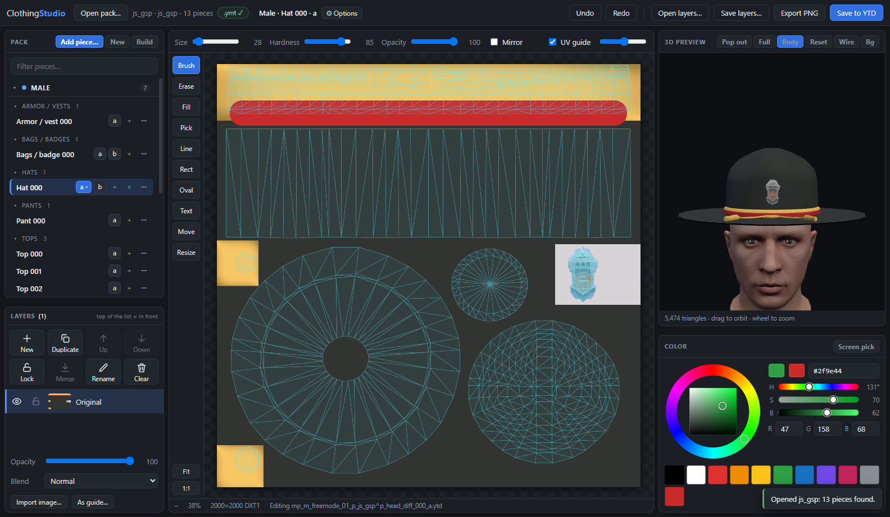

</div>

Open an addon clothing resource (a folder with `stream/`, `.meta` files and `fxmanifest.lua`), pick a hat, top, pair of
pants or badge, **paint on its texture while the 3D model updates as you go**, and press **Save to YTD**. It also does the
boring parts of running a clothing pack: adding, moving and deleting pieces without breaking the numbering, adding more
textures (`a`, `b`, `c` …), keeping the pack's `.ymt` right, and building a clean FiveM resource.

> No more exporting a texture, editing it in another program, importing it back, and loading the game to see what it
> looks like.

---

## What you get

### Paint like in a normal image editor

| | |
|---|---|
| 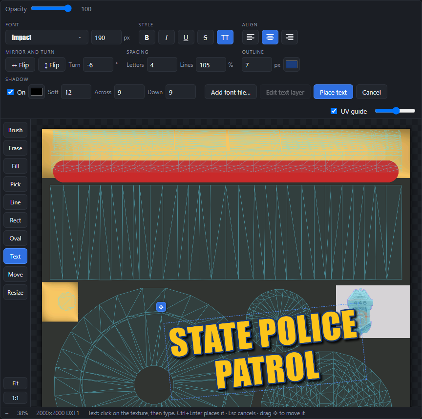 | **Text that stays editable.** Click the texture and type. Pick any font installed on your PC (each shown in its own face), size, **bold / italic / underline / strikethrough / ALL CAPS**, alignment, **letter and line spacing**, **outline**, **drop shadow**, **mirror** the text left-right or up-down, **turn** it to any angle. The text is on its own layer marked **T**: click it again later to retype or restyle it. You can also load a font file. |
| 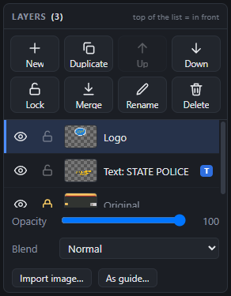 | **Layers with big, clear buttons.** New, Duplicate, Up, Down, Lock, Merge, Rename, Delete, each with a picture *and* a word. Eye and padlock on every layer, opacity and blend modes, import an image as a layer or as a see-through guide. A **locked** layer cannot be painted on, moved or deleted by accident. |
| 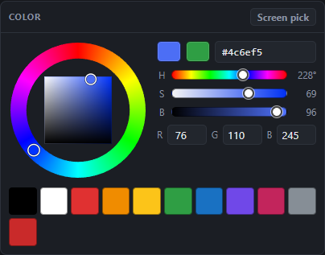 | **A proper colour wheel** with hue ring and saturation / brightness square, H S B and R G B boxes, hex field, previous colour, recent colours and **screen pick** (grab a colour from anywhere on your screen). |
| 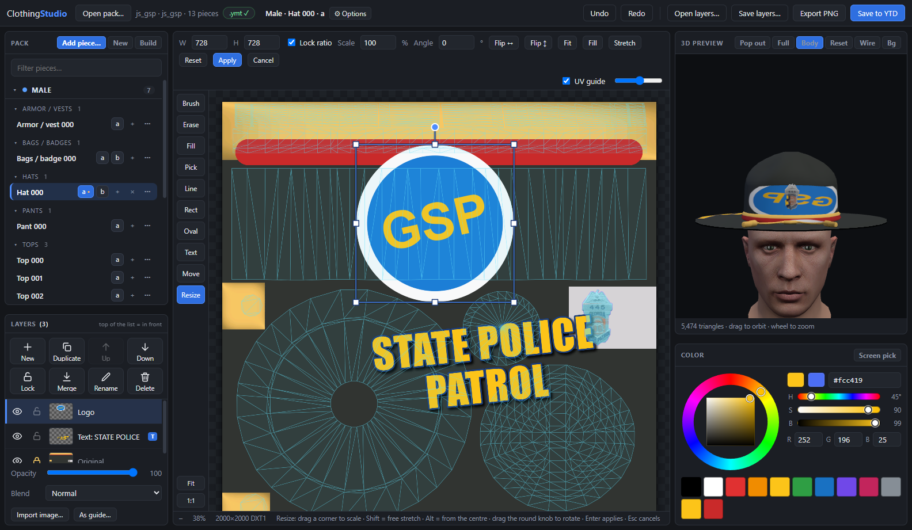 | **Resize tool.** Move, scale, rotate and flip any layer, with handles *and* exact numbers, plus Fit / Fill / Stretch. Drop in a logo, size it, done. |

Also: brush with hardness and pressure, eraser, fill, colour picker, line, rectangle, oval, mirror painting, move layer,
zoom and pan, undo / redo, export PNG, save your layers to a file and carry on later, paste or drop images in.

### See it on the model, live

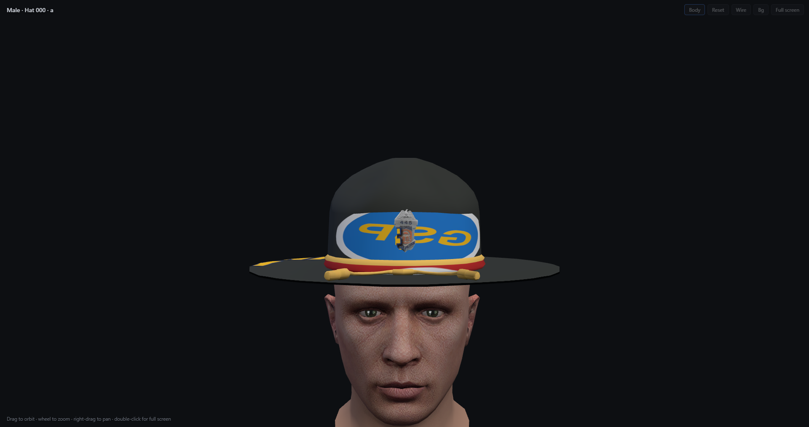

The 3D view updates **while you paint**. Show it **full screen**, or **pop it out into its own window on a second
monitor**. Turn on **Body** to see the piece on a freemode mannequin (read from *your own* copy of GTA V; see
[the guide](docs/USER-GUIDE.md#the-3d-view)). The coloured wireframe on the canvas is the model's real UV layout, so you
can see exactly what you are painting.

### Manage the pack

| | |
|---|---|
| 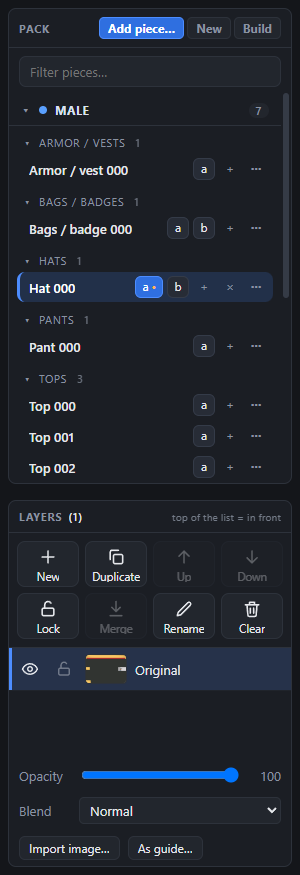 | **Pack list.** Male and Female, grouped by category, with a filter box and a **⋯** menu on every piece. |
| 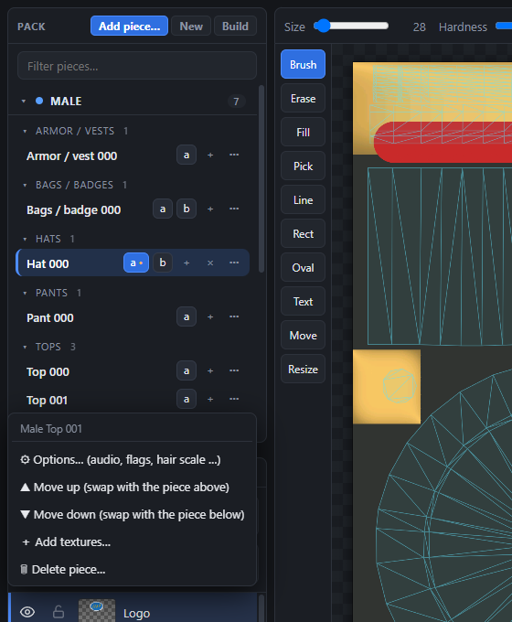 | **Move, swap, delete, add textures.** Move *Top 002* up and it swaps with *Top 001* (model and every texture renamed together). Delete *Top 001* and *Top 002* becomes *Top 001*. Everything the game stores by number (the `.ymt`) follows. Deleted files go to the **Recycle Bin**. |
| 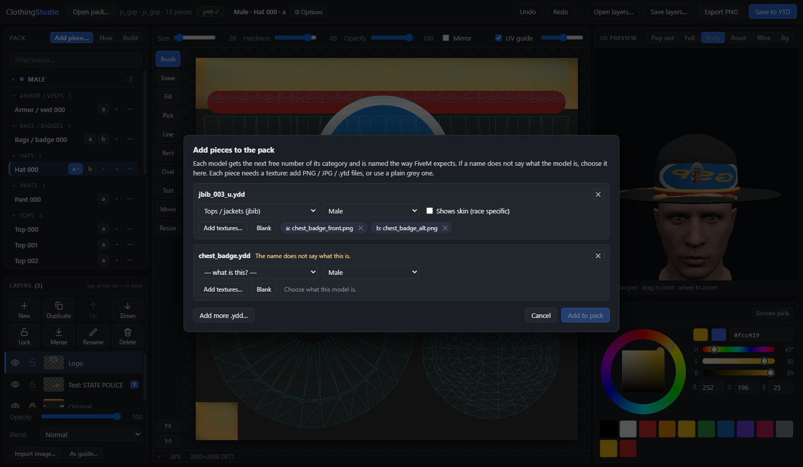 | **Add pieces.** Drop `.ydd` models in. If a name does not say what it is (say `chest_badge.ydd`) the app asks: badge, hat, pants …, male or female, shows skin or not. Add textures from PNG / JPG / WEBP or ready-made `.ytd` files. |
| 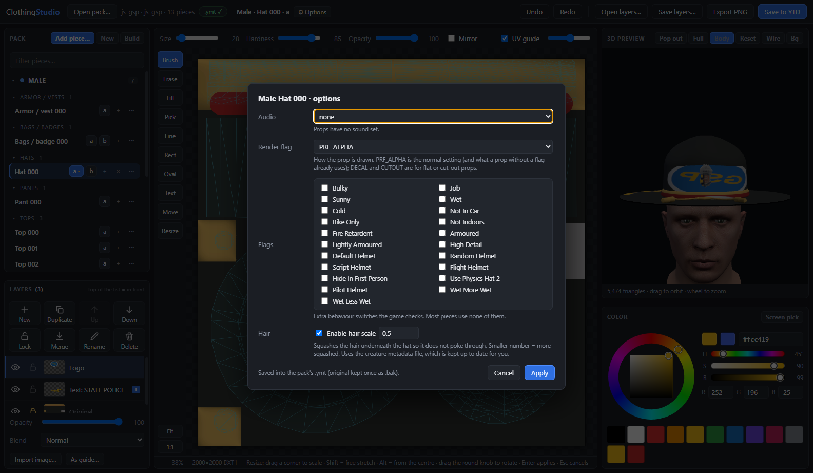 | **Piece options** like grzyClothTool's *Drawable Options*: audio, flags, render flag, **hair scale** for hats, **high heels** for shoes, shows skin. The `.ymt` and the creature metadata file are kept right for you. |
| 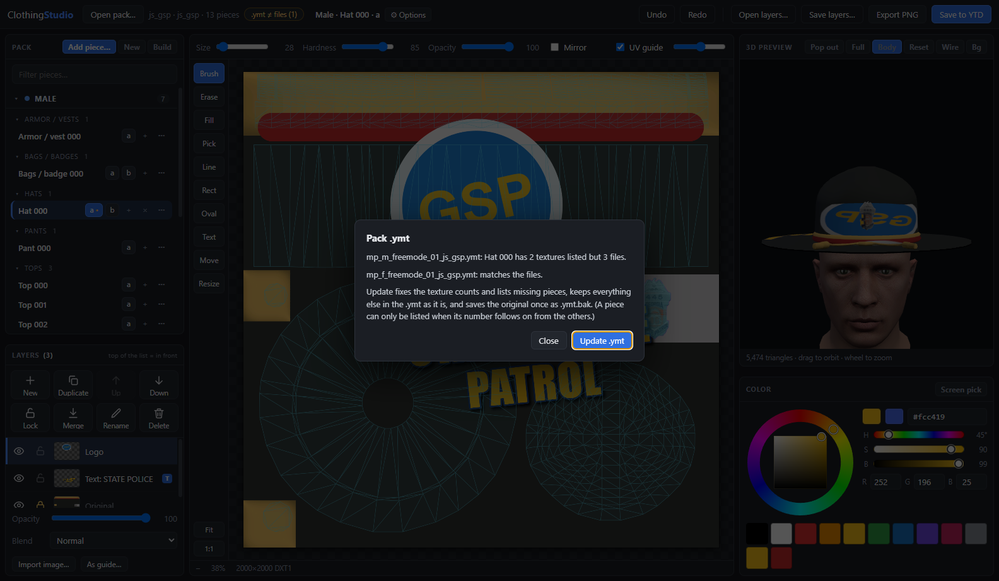 | **The `.ymt` is kept in step.** The top bar tells you if the `.ymt` matches your files, and one click fixes it. The original is saved once as `.bak`. |

**New** makes an empty pack, **Build** writes a clean FiveM resource you can drop into your server's `resources` folder.

### Built to not lose your work

- Every `.ytd` / `.ymt` is backed up once as `.bak` the first time it is changed.
- Nothing is deleted for good: removed files go to the Windows **Recycle Bin**, under their real name, so *Restore* works.
- A journal records every rename while an operation runs, so a crash or power cut half way is **undone automatically**
  the next time you open the pack.
- New `.ymt` files are re-read and checked before they replace the old one; ones the app does not fully understand are
  left alone and reported.
- 100+ automated tests cover the file formats and every pack operation (`npm test`, no game files needed).

---

## Quick start

**Easiest: download the ready-to-run program.** Open the **[Releases](../../releases)** page, download
`ClothingStudio-…-win-x64.zip`, unzip it anywhere (your desktop, a USB stick) and double-click `ClothingStudio.exe`.
Nothing to install. (Windows may warn about an "unknown publisher" because the program is not code-signed: choose
*More info → Run anyway*, or build it yourself from the source as below.)

**From the source code** (needs **Windows 10 or 11** and [Node.js 20+](https://nodejs.org/)): click the green **Code** button
above → **Download ZIP** (or `git clone` the repository), open a terminal in the unzipped folder, then:

```bash
npm install
npm start                # run it
npm run package          # or build your own portable copy: dist/ClothingStudio-win32-x64/ClothingStudio.exe
```

Then:

1. **Open pack…** (or drag your resource folder onto the window).
2. Click a piece in the **Pack** list, then a texture letter (`a`, `b` …).
3. Paint. Watch the 3D view.
4. **Save to YTD** (Ctrl+S). Restart / refresh the resource on your server.

New to this? Follow the **[tutorial](docs/TUTORIAL.md)**; it takes about ten minutes and covers painting, text, layers,
adding a piece and building the resource.

---

## Documentation

| Document | What is in it |
|---|---|
| **[Tutorial](docs/TUTORIAL.md)** | Your first custom hat, step by step, with pictures |
| **[User guide](docs/USER-GUIDE.md)** | Every tool, button and shortcut, explained |
| **[Pack format](docs/PACK-FORMAT.md)** | How a clothing pack is organised: file names, `.ymt`, creature metadata, what each option does |
| **[Troubleshooting](docs/TROUBLESHOOTING.md)** | "It says…", "I can't…", "The game shows…" |
| **[Technical notes](docs/TECHNICAL.md)** | How it works inside: file formats, safety design, tests, building |
| [Changelog](CHANGELOG.md) · [Contributing](CONTRIBUTING.md) · [Notices & credits](NOTICE.md) | |

---

## Good to know

- **Verified by decoding, re-encoding and re-reading real packs, not by loading them in GTA V.** Keep the `.bak` files
  until you have looked at the result in game.
- Textures are written back at their original size and format (DXT1, DXT5 or A8R8G8B8, mips regenerated). DXT is
  compressed, so very smooth photographic gradients can band slightly; logos and flat art look great.
- ClothingStudio edits textures and the pack's bookkeeping files. It does not edit the 3D models themselves.
- Splitting packs of more than 128 pieces, and the *replace* / *singleplayer* / AltV layouts, are not done yet.
- The mannequin needs the **legacy** GTA V edition installed; everything else works without any game installed.

## Credits and legal

ClothingStudio stands on the shoulders of **[CodeWalker](https://github.com/dexyfex/CodeWalker)** (file-format knowledge,
GPL-3.0) and takes its conventions from **[grzyClothTool](https://github.com/grzybeek/grzyClothTool)**. See
**[NOTICE.md](NOTICE.md)** for the full list.

This is a fan-made tool and is **not affiliated with Rockstar Games, Take-Two, Cfx.re or FiveM**. It contains no game
files. Only open packs you have the right to modify.

## License

[GPL-3.0-or-later](LICENSE). Because parts of this project follow GPL-3.0 code from CodeWalker, anything you distribute
that includes ClothingStudio must also be GPL-3.0.
