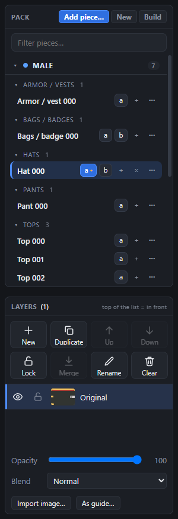
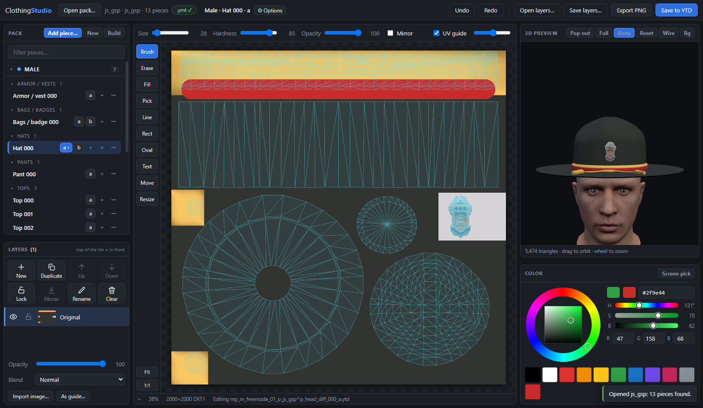
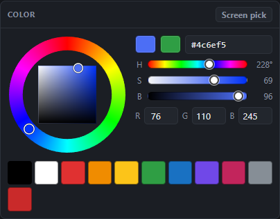
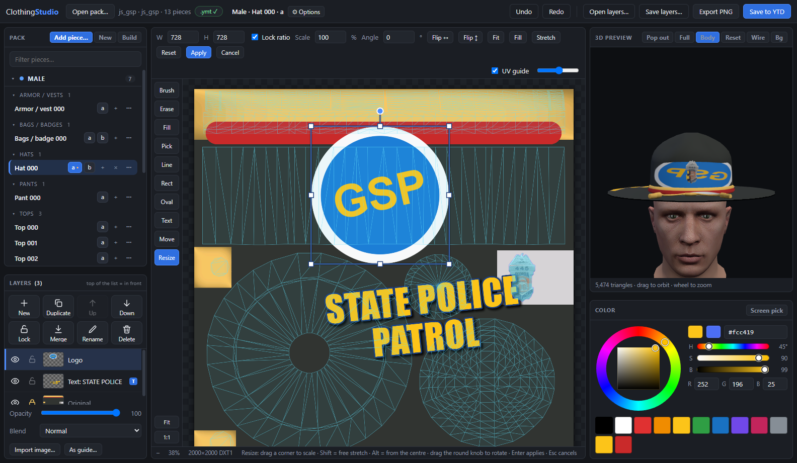
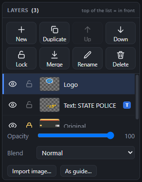
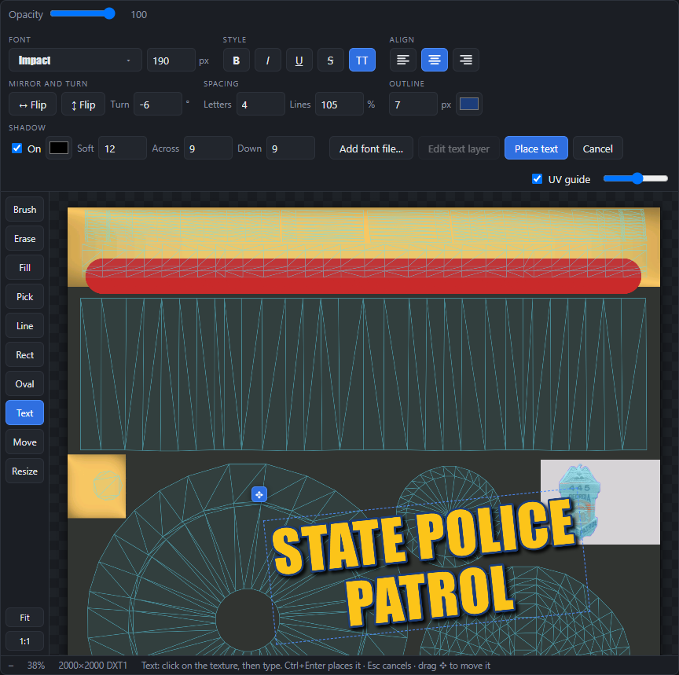
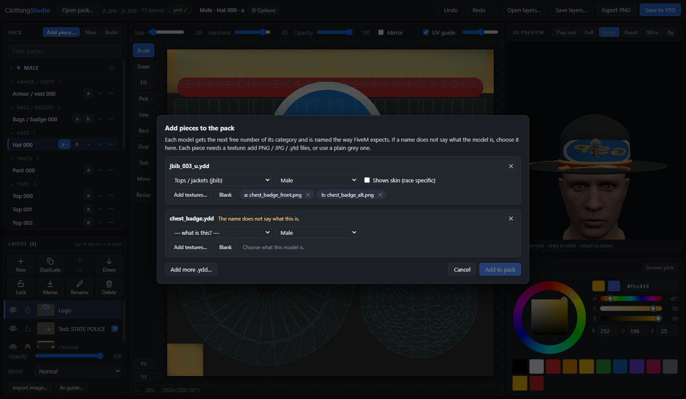
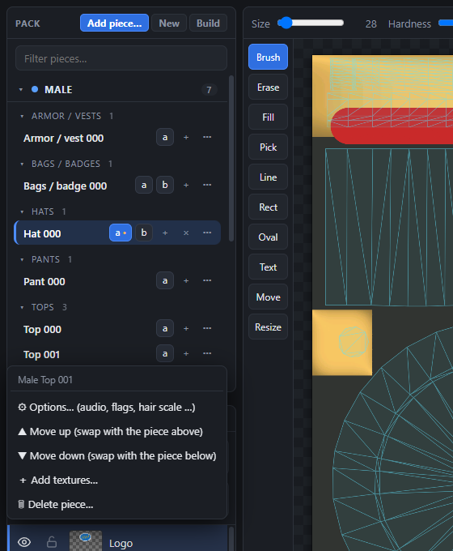
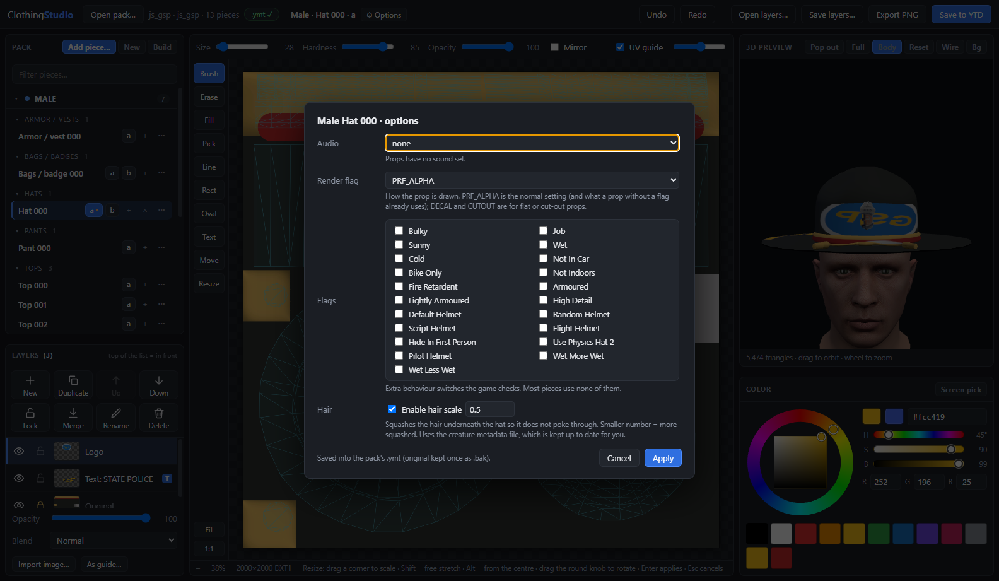

# Tutorial: your first custom hat

About ten minutes. By the end you will have painted a texture with a logo and text, saved it into the pack, made a
second colour version, added a brand-new piece, and built a resource for your server.

**You need:** ClothingStudio running ([how](../README.md#quick-start)) and an addon clothing pack, which is a folder that
contains `stream/`, a couple of `.meta` files and `fxmanifest.lua`. No pack yet? Press **New** in the app and it makes
an empty one for you (step 8).

> **Golden rule.** The first time a file is changed, the original is kept next to it as `<name>.bak`, and anything you
> delete goes to the Recycle Bin. Keep the `.bak` files until you have checked the result in game.

---

## 1. Open your pack

Press **Open pack…** (top left) and choose the resource folder, or just **drag the folder onto the window**.

The **Pack** list on the left shows everything in the pack, **Male** first, then **Female**, grouped by what it is
(hats, tops, pants …). Next to each piece are its textures: `a`, `b` … Click a name to open the piece, or a letter to
open that texture.

The chip at the top, **.ymt ✓**, means the pack's `.ymt` agrees with the files. If it says **.ymt ≠ files**, click it
and it tells you what differs (see step 9).

## 2. Look at your piece

Click a hat (or any piece). The middle shows its **texture**; the right shows the **3D model**.

- The **coloured lines** on the texture are the model's real UV map: they show you which part of the texture lands on
  which part of the model. Untick **UV guide** (top right of the canvas) to hide them.
- **Drag** in the 3D view to turn the model, **scroll** to zoom. **Body** shows a mannequin, **Wire** shows the mesh,
  **Bg** changes the background. **Full** makes the 3D view fill the window; **Pop out** puts it in its own window for a
  second monitor.

## 3. Paint

Pick the **Brush** (key `B`). On the right, click in the **colour wheel** to choose a colour: the ring is the hue, the
square inside is saturation and brightness. You can also type a hex like `#c92a2a`.

Drag on the texture to paint. **Size** and **Hardness** are above the canvas (`[` and `]` change the size). Watch the model
change as you paint. Made a mistake? **Ctrl+Z**.

Handy: **Alt+click** picks a colour from the texture, **X** swaps with the previous colour, **Space+drag** (or the middle
mouse button) pans, **scroll** zooms, **F** fits the whole texture in the window.

## 4. Add a logo

Logos should never be painted straight onto the base texture, so they get their own layer.

1. In the **Layers** panel press **Import image…** and pick a PNG with a see-through background. (You can also **drop an
   image on the window** or paste one with Ctrl+V.)
2. The app switches to the **Resize** tool. Drag a **corner** to make it bigger or smaller, drag **inside** to move it,
   drag the round **knob** to turn it. The bar above the canvas has exact numbers (**W**, **H**, **Scale**, **Angle**), **Flip**
   buttons, and **Fit / Fill / Stretch**.
3. Press **Apply** (or Enter).

Now **lock** the base layer so you cannot paint on it by accident: click the **Original** layer, then press **Lock** in
the Layers panel.

The buttons are labelled, so: **New** adds an empty layer, **Duplicate** copies the selected one, **Up / Down** change what is
in front, **Lock** protects it, **Merge** joins it into the layer below, **Rename**, **Delete**. The eye hides a layer, the
padlock locks it. Shortcuts: `Ctrl+J` duplicate, `Ctrl+E` merge down, `Ctrl+]` / `Ctrl+[` up / down.

## 5. Add text

1. Press the **Text** tool (key `T`).
2. **Click** where the text should go and **type**. What you see is what gets painted.
3. Choose the look with the bar above the canvas:

| Group | What it does |
|---|---|
| **Font** | The big button opens the list of every font on your PC, each shown in its own style. Type to search, or type the name of any font and press Enter. **Add font file…** loads a `.ttf` / `.otf` / `.woff` that is not installed. The number is the size in texture pixels. |
| **Style** | **B**old, *I*talic, <u>U</u>nderline, ~~S~~trikethrough, **TT** = ALL CAPS |
| **Align** | left, centre, right (for text with more than one line; press Enter for a new line) |
| **Mirror and turn** | **↔ Flip** reverses the text left-to-right, **↕ Flip** turns it upside down, **Turn** rotates it by any angle |
| **Spacing** | **Letters** = space between letters, **Lines** = line height in % |
| **Outline** | thickness in pixels (0 = none) and its colour |
| **Shadow** | tick **On**, then colour, **Soft** (blur), **Across** and **Down** (how far it falls) |

The text colour is the colour in the colour wheel; **Opacity** is at the left of the bar. Drag the **✥** handle to move the
text.

4. Press **Place text** (or `Ctrl+Enter`, or click somewhere else on the texture). `Esc` throws it away.

**It stays editable.** The text is now its own layer, marked with a blue **T**. Click the text again with the Text tool
(or double-click the layer, or press **Edit text layer**) and everything comes back exactly as you left it: change the
words, the font, flip it, move it. If you delete all the words and place it, the layer is removed. **Undo** walks back
through every edit.

> If you paint on a text layer with the Brush, or resize it with the Resize tool, it turns into ordinary pixels
> (the **T** disappears). Undo makes it text again.

## 6. Save it into the pack

Press **Save to YTD** (top right, or `Ctrl+S`). A box tells you which file will be overwritten; press **Write to YTD**.

The first time, the original is kept as `<name>.ytd.bak`. The layers are flattened into the texture. Want to keep your
layers for later? Use **Save layers…** (a `.csproj` file) and **Open layers…** next time.

Then on your server: `refresh`, `restart <your resource>` (or restart the server), and look in game.

## 7. Make another colour (texture `b`, `c` …)

Every piece can have several textures, which show up in game as the colour / style choices for that item. On the piece in
the Pack list press the little **+** after its letters: the texture you are editing is copied to the next letter and opened.
Paint it a different colour and save.

To get rid of one: select it and press the **×** after the letters (or right-click the letter). The files after it move
down a letter so there are no gaps (delete `c` of `a b c d` and the old `d` becomes `c`). The app updates the `.ymt` for you.

## 8. Add a brand-new piece

Got a `.ydd` model from somewhere? Press **Add piece…** (or drop the `.ydd` on the window).

- If the file name says what it is (`jbib_003_u.ydd`), the app already knows. If not (`chest_badge.ydd`), it asks: **what is
  this?** (badge, hat, pants …), **male or female**, and **shows skin** or not.
- Each piece needs at least one texture: **Add textures…** (PNG / JPG / WEBP or `.ytd`) or **Blank** for a plain grey one.
- Press **Add to pack**. The model gets the next free number and FiveM-style file names, and goes into the `.ymt`.

No pack to start with? **New** makes an empty resource (manifest, `.meta` files, empty `.ymt`s, `stream/`) in a folder you
choose and then asks which models to put in it.

## 9. Move or delete pieces

Every piece has a **⋯** button (or right-click it).

- **Move up / Move down** swaps it with its neighbour. Models, textures and `.ymt` entries all follow, and unsaved painting
  stays with the right piece.
- **Delete piece…** moves the model and its textures to the Recycle Bin and renumbers the later ones (delete *Top 001* and
  *Top 002* becomes *Top 001*).
- **Add textures…** adds PNG / JPG / WEBP / `.ytd` files as new letters.
- **Options…** is next.

If the top-bar chip ever says **.ymt ≠ files**, click it, read the list, and press **Update .ymt**: only the texture counts
change, everything else in the file stays as it was.

## 10. Piece options (hats and shoes especially)

Open **⚙ Options** (next to the piece name) or **⋯ → Options…**.

- **Hats:** tick **Enable hair scale** if hair pokes through the hat. A smaller number squashes the hair more (try 0.35).
- **Shoes:** **High heels** lifts the character so heels stand on the ground (larger = taller).
- **Audio** is the sound the item makes, **Flags** are special behaviours, **Render flag** is for props (leave as is unless
  you know you need *Decal* or *Cutout*), **Shows skin** is for items that show the body underneath (pants, shoes).

Only what you change is written, and the creature-metadata file that hair scale and heels need is created, updated or
removed for you.

## 11. Build a resource for your server

Press **Build**, choose an output folder (and, if you want, a new name). You get a clean FiveM resource: renamed stream files,
a rebuilt `.ymt` with every piece listed, the `.meta` files and an `fxmanifest.lua`. Copy the folder into your server's
`resources` folder and add `ensure <name>` to your `server.cfg`.

---

## Where next?

- Every tool and button: **[User guide](USER-GUIDE.md)**
- How packs are put together: **[Pack format](PACK-FORMAT.md)**
- Something went wrong: **[Troubleshooting](TROUBLESHOOTING.md)**
