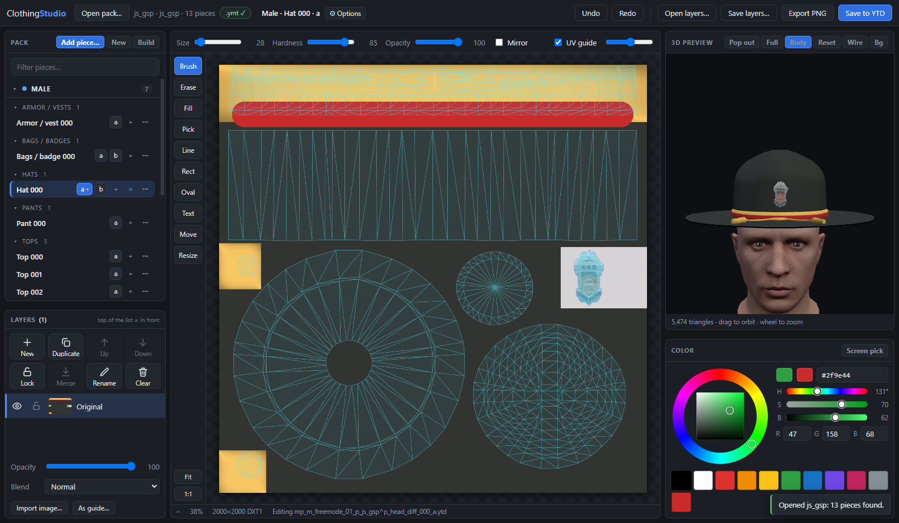
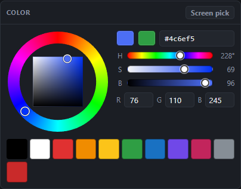
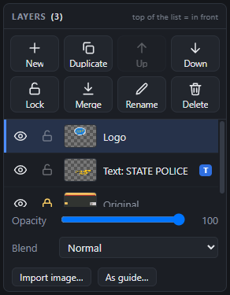
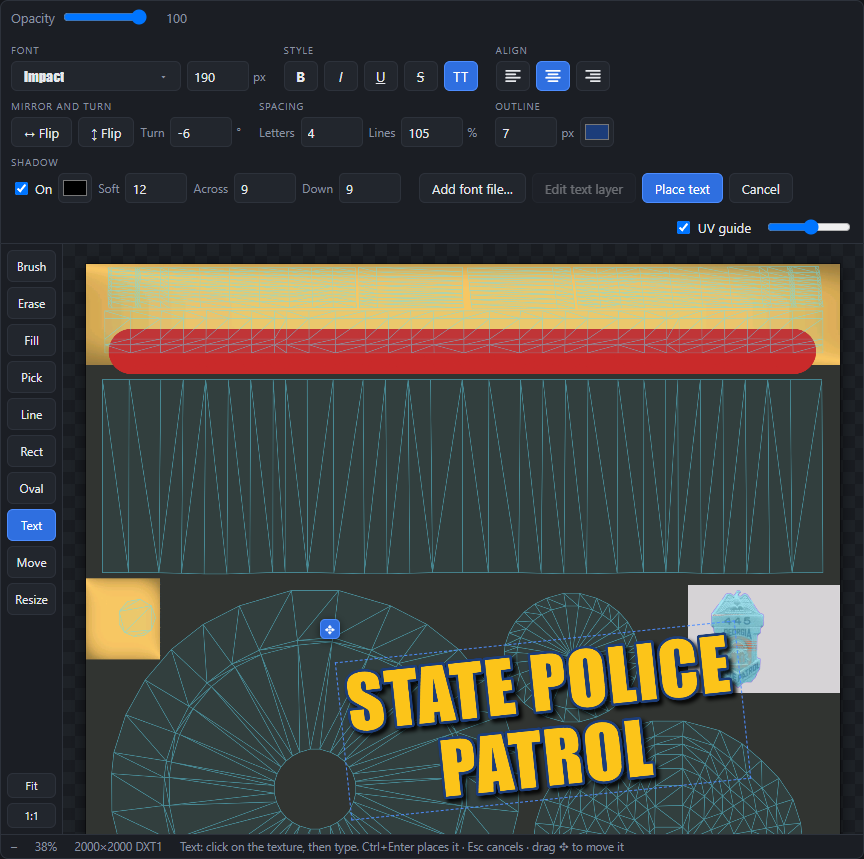
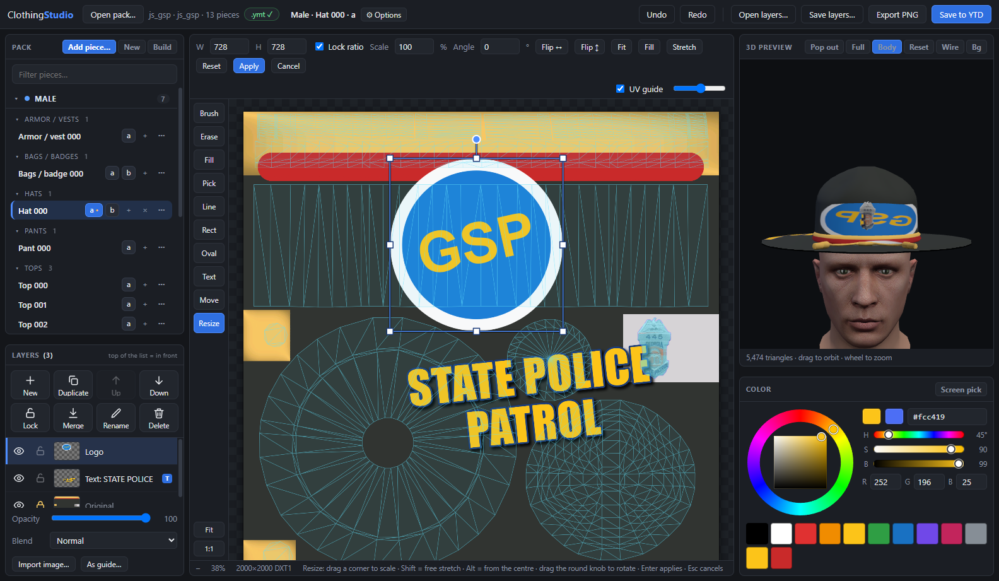
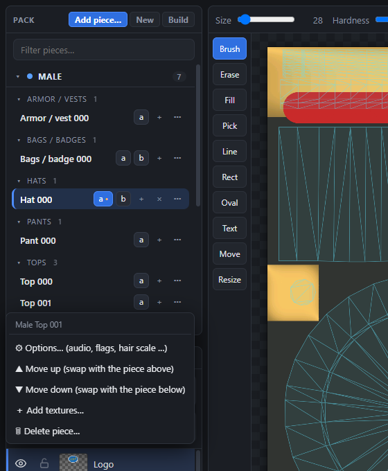
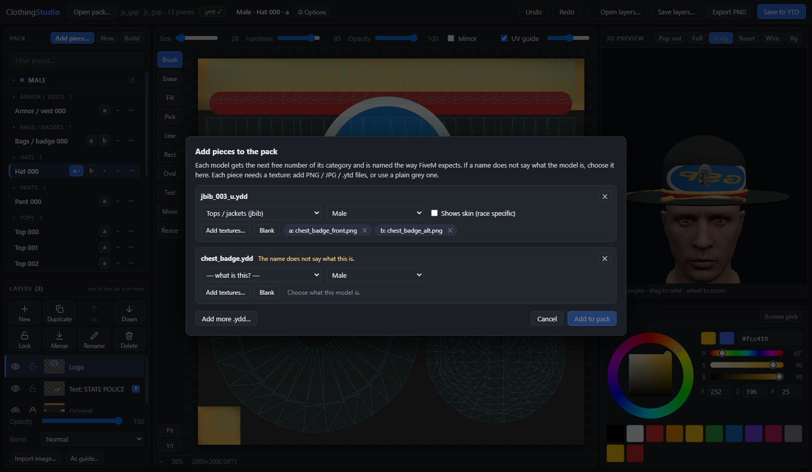
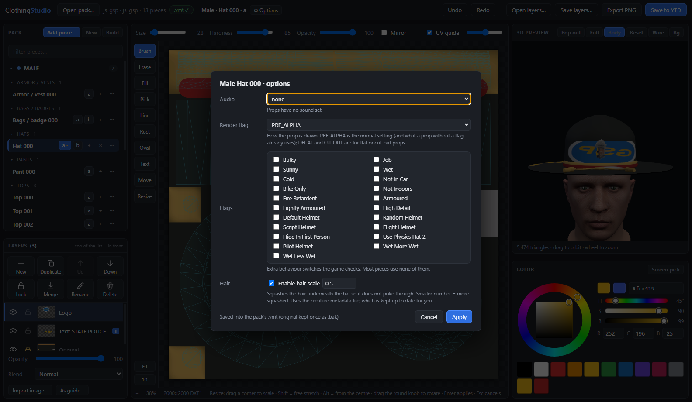
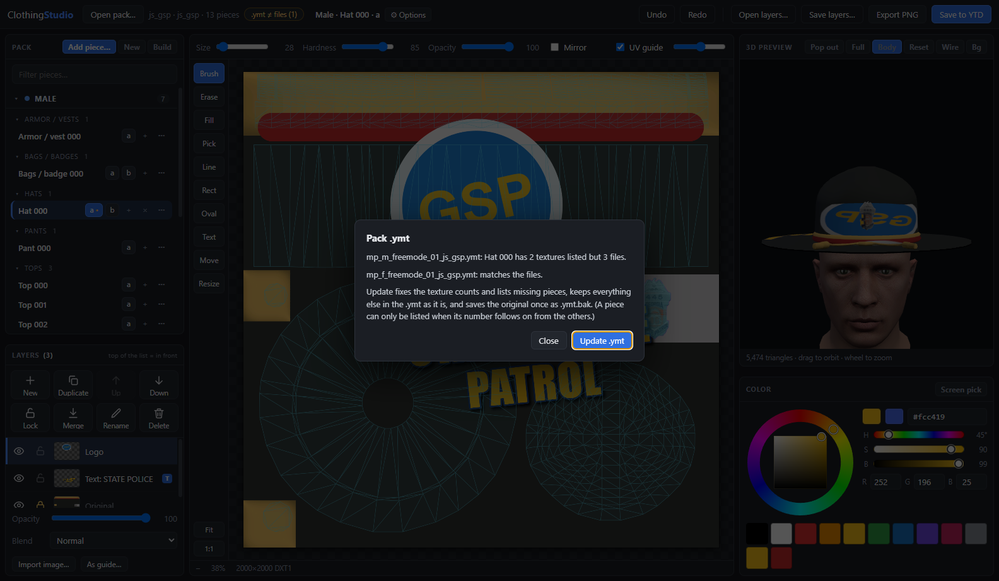

# User guide

Everything ClothingStudio can do, in the order you meet it. New here? Do the **[tutorial](TUTORIAL.md)** first.

**Contents:** [The window](#the-window) · [Opening a pack](#opening-a-pack) · [Tools and keys](#tools-and-keys) ·
[Colour](#colour) · [Layers](#layers) · [The Text tool](#the-text-tool) · [The Resize tool](#the-resize-tool) ·
[The 3D view](#the-3d-view) · [Texture variants](#texture-variants-a-b-c-) · [Pieces](#pieces-add-move-delete) ·
[Piece options](#piece-options) · [The .ymt](#the-pack-ymt) · [New pack and Build](#new-pack-and-build) ·
[Saving and exporting](#saving-and-exporting) · [Files the app creates](#files-the-app-creates)

---

## The window

| Area | What it is |
|---|---|
| **Top bar** | Open pack, the **.ymt** status chip, the piece you are editing and its **⚙ Options**, Undo / Redo, **Open layers… / Save layers…**, **Export PNG**, **Save to YTD** |
| **Pack** (left, top) | Every piece in the pack. **Add piece…**, **New**, **Build**, a filter box, Male / Female sections |
| **Layers** (left, bottom) | The layers of the texture you are editing, with their buttons, opacity and blend mode |
| **Options bar** (above the canvas) | Settings of the selected tool. It only shows what applies to that tool |
| **Tool strip** (left of the canvas) | Brush, Erase, Fill, Pick, Line, Rect, Oval, Text, Move, Resize, Fit, 1:1 |
| **Canvas** (middle) | The texture. The coloured lines are the model's UV layout (tick or untick **UV guide**) |
| **3D preview** (right, top) | The model, live. **Pop out · Full · Body · Reset · Wire · Bg** |
| **Colour** (right, bottom) | The colour wheel and swatches |
| **Status bar** (bottom) | Pointer position, zoom, texture size and format, and hints for the tool you are using |

## Opening a pack

**Open pack…** or drop the resource folder on the window. A pack folder is the one that has `stream/` in it (usually with
`fxmanifest.lua` and `.meta` files next to it). Pieces are found by their file names, see [Pack format](PACK-FORMAT.md).

If an earlier operation was cut short (crash, power cut), opening the pack **undoes it automatically** and tells you what it
put back.

## Tools and keys

| Key | Tool | What it does |
|---|---|---|
| `B` | **Brush** | Paints with the chosen colour. **Size**, **Hardness**, **Opacity** above the canvas; pen pressure is used if you have a pen tablet |
| `E` | **Erase** | Rubs out to see-through |
| `G` | **Fill** | Flood fill. **Tolerance** decides how similar a colour must be to be filled |
| `I` | **Pick** | Click to take the colour under the pointer. **Alt+click** does this with any tool |
| `L` / `R` / `O` | **Line / Rect / Oval** | Drag to draw. **Filled** switches rectangle and oval between outline and solid. **Shift** keeps lines at 45° steps and shapes square / round |
| `T` | **Text** | See [The Text tool](#the-text-tool) |
| `V` | **Move** | Drags the selected layer. The mouse wheel scales it |
| `S` or `Ctrl+T` | **Resize** | See [The Resize tool](#the-resize-tool) |
| `F` | Fit | Fit the whole texture in the window. **1:1** shows real pixels |

More keys:

| Keys | Does |
|---|---|
| `Ctrl+Z`, `Ctrl+Y` (or `Ctrl+Shift+Z`) | Undo, redo (many steps, also for layer operations) |
| `Ctrl+S` | Save to YTD |
| `X` | Swap the current and the previous colour |
| `[` and `]` | Smaller / bigger brush |
| Space + drag, or middle mouse drag | Pan |
| Mouse wheel | Zoom (with the Move tool the wheel scales the layer; hold `Ctrl` to zoom instead) |
| `Ctrl+J` | Duplicate the selected layer |
| `Ctrl+E` | Merge the selected layer down |
| `Ctrl+]`, `Ctrl+[` | Move the selected layer up / down |
| `F11` | 3D view full screen (`Esc` leaves) |

**Mirror** (next to the brush options) paints a mirror image on the other side of the texture; it is shown for the tools
it works with (brush, eraser, line, rect, oval). Paste an image with `Ctrl+V` or drop an image file on the window and it
becomes a layer.

## Colour

- The **ring** is the hue, the **square** is saturation (left to right) and brightness (bottom to top).
- **H / S / B** sliders and **R / G / B** boxes for exact numbers, a **hex** field (`#f80` shorthand works).
- The two big swatches at the top are the **current** colour and the **previous** one: click the previous one (or press `X`)
  to swap back.
- **Screen pick** takes a colour from anywhere on your screen, even outside the app.
- The row of small swatches is a palette; colours you used recently collect below it.

## Layers

The list shows the **front-most layer first**. Click a layer to select it.

**The eight buttons** (each shows what it does; they grey out when they cannot apply):

| Button | Does |
|---|---|
| **New** | An empty, see-through layer above the selected one |
| **Duplicate** | A copy of the selected layer (a text layer stays editable). `Ctrl+J` |
| **Up / Down** | Move the layer in front of / behind its neighbour. `Ctrl+]` / `Ctrl+[` |
| **Lock / Unlock** | A locked layer cannot be painted on, erased, filled, moved, resized, merged or deleted. You can still hide it or change its opacity and blend mode |
| **Merge** | Joins the selected layer into the one below it, using its opacity and blend mode. `Ctrl+E` |
| **Rename** | Gives it a name (double-clicking the name does the same) |
| **Delete** | Removes the layer. With only one layer it says **Clear** and wipes the layer instead. Undo brings it back |

**On each row:** the **eye** shows / hides the layer, the **padlock** locks it, the thumbnail shows its contents, a blue **T** marks
live text (double-click it to edit).

**Below the list:** **Opacity** and **Blend** (Normal, Multiply, Screen, Overlay, Soft light, Darken, Lighten) of the selected layer; **Import image…**
adds a picture as a new layer and drops you straight into the Resize tool; **As guide…** shows a picture as a see-through
tracing guide (never saved into the texture).

**Save to YTD** flattens all visible layers. **Save layers…** keeps them (and live text) in a `.csproj` file you can open
again with **Open layers…**.

## The Text tool

Press `T`, **click** the texture and **type**. The text is drawn on the canvas exactly as it will be painted: there is no
"preview" that differs from the result. A dashed box shows the text block; the **✥** handle at its corner drags it.

### The controls

| Group | Control | What it does |
|---|---|---|
| **Font** | Font button | Opens the list of every font installed on your PC (each in its own face). Type to search; type any name and press Enter to use it. `↑ ↓` move, `Enter` picks, `Esc` closes |
| | Size | Text size in texture pixels (6 – 2000) |
| **Style** | **B** *I* <u>U</u> ~~S~~ **TT** | Bold, italic, underline, strikethrough, ALL CAPS |
| **Align** | three buttons | Left / centre / right within the block, for several lines |
| **Mirror and turn** | **↔ Flip** | Mirrors the text left-to-right, so it reads backwards (use it for parts of the model that are mirrored in the texture) |
| | **↕ Flip** | Mirrors it upside down |
| | **Turn** | Rotates by any angle (−360° … 360°) about the middle of the text |
| **Spacing** | **Letters** | Extra space between letters in pixels (negative tightens) |
| | **Lines** | Line height in % of the size |
| **Outline** | thickness + colour | A border around every letter. 0 = none |
| **Shadow** | **On**, colour, **Soft**, **Across**, **Down** | A drop shadow: how blurry, and how far to the right and down it falls (negative = left / up) |
| (left of the bar) | **Opacity** | See-through-ness of the text |
| (colour wheel) | text colour | The current colour |
| | **Add font file…** | Loads a `.ttf` / `.otf` / `.woff` / `.woff2` file for this session |
| | **Edit text layer** | Opens the selected text layer for editing |
| | **Place text** / **Cancel** | Keep / throw away the changes |

Every change shows immediately, and the text box turns and mirrors with it so you can keep typing.

### Placing, editing, removing

- **Place** with the **Place text** button, `Ctrl+Enter`, by clicking somewhere else on the texture (which starts the next text),
  by choosing another tool, by picking another piece, or when you save. `Esc` or **Cancel** discards what you typed.
- Placed text becomes **its own layer** named `Text: …` with a blue **T**. It remembers *everything*: words, font, size, style,
  colour, spacing, outline, shadow, flip, angle, position and opacity.
- **To change it later:** with the Text tool click the text on the texture; or double-click the **T** / thumbnail of the layer;
  or select the layer and press **Edit text layer**. While editing, its pixels are replaced by the live preview. Change anything,
  then place it again. One **Undo** goes back to the previous version.
- Clearing all the words and placing removes the layer (Undo brings it back).
- A **locked** or **hidden** text layer cannot be edited until you unlock / show it.
- **Painting never costs you the text.** If a text layer is selected and you paint with the **Brush, Line, Rect or Oval**, your
  painting goes on a layer of its own just above it (named *Paint over text*; a note tells you), so the words stay editable. Keep
  painting and it keeps using that layer. To paint straight onto the text, merge the two layers.
- **Move, Resize and the mouse wheel keep it editable too.** The **Move** tool, the **Resize** tool (corners, rotate knob, Flip,
  Fit / Fill, the W / H and Angle boxes) and the wheel over the Move tool change the text's own settings (position, size, turn,
  mirror), so the text stays live, sharp (it is painted again at the new size, never stretched) and retypable. The ✥ handle still
  moves it while you edit.
- **What does turn text into plain pixels:** **Erase**, **Fill**, **Merge** into the layer below (or merging something into the
  text layer), and stretching it **one way only** (a width and height that differ). Text settings cannot say "wider but not taller".
  The blue **T** goes and a note says so. **Undo** brings the editable text back.
- Your last text settings (font, size, style …) are remembered for next time.

## The Resize tool

Select **Resize** (`S` / `Ctrl+T`) to move, scale, rotate and flip the selected layer. Importing, dropping or pasting an image
puts you here at once.

- **Corners** scale proportionally (`Shift` = stretch freely, `Alt` = scale from the centre); **edge handles** stretch one way.
- Drag **inside** the box to move (`Shift` = one direction; arrow keys nudge 1 px, `Shift`+arrow 10 px).
- Drag the **round knob** (or just outside a corner) to rotate (`Shift` snaps to 15°).
- The bar has exact **W / H** in pixels, **Lock ratio**, **Scale %**, **Angle**, **Flip ↔ / ↕**, **Fit / Fill / Stretch** (to the
  texture), **Reset**.
- **Enter** / **Apply** bakes it in (one undo step). **Esc** / **Cancel** discards. Switching tool applies it.
- The layer is re-drawn from its original pixels on every change, so scaling up and down does not pile up blur. Anything
  pushed outside the texture is cropped when applied. The 3D view follows live.

## The 3D view

| Button | Does |
|---|---|
| **Pop out** | Opens the 3D view in its own window, on another monitor if you have one. Live while you paint, follows the piece you select. Double-click / `F` / `F11` there = full screen, `R` = reset the camera |
| **Full** (`F11`) | The 3D view fills the app window. `Esc` or **Exit** returns |
| **Body** | Shows the piece on a freemode mannequin (see below) |
| **Reset** | Back to the default camera |
| **Wire** | Shows the mesh as lines |
| **Bg** | Cycles the background |

Drag to orbit, scroll to zoom, right-drag to pan.

### The mannequin

**Body** reads the default freemode head, torso, legs and feet straight out of **your own GTA V installation** (legacy edition)
the first time you use it. Hats and glasses sit on the head bone; pants, shoes and torsos hide the matching body part so you can see
the garment itself.

- The GTA V folder is found automatically (Steam, Rockstar, Epic, any drive). If not, press **Body** and choose the folder that has
  `GTA5.exe` in it.
- The game's archives are encrypted. The app unlocks them with a key found inside **your** `GTA5.exe` (the same method CodeWalker uses)
  and caches it as `keys.bin` in the app's data folder (`%APPDATA%\ClothingStudio`). Nothing from the game is copied anywhere else.
- Heads are the game's default shapes (male parent 0, female parent 21); real in-game faces are blended at run time, so faces
  will not match a particular character.
- Without GTA V installed everything else still works; you just see the garment without a body.

## Texture variants (a, b, c …)

A piece can have up to 26 textures; in game they are the colour / style choices of that item.

- The chips after a piece's name are its textures. Click one to edit it.
- **+** makes the next letter as a **copy** of the texture you are editing (if you have unsaved painting on it you can start the new
  one from the painting instead of the saved file). Nothing existing is changed.
- **×** (or right-click a letter) deletes that texture. It goes to the Recycle Bin and the later ones **move down a letter** (delete
  `c` of `a b c d`: the old `d` becomes `c`; unsaved painting follows it). A piece always keeps at least one texture.
- The `.ymt` is updated right after, so the game sees the new count.

## Pieces: add, move, delete

The Pack list is grouped into **Male / Female** and categories (click a header to fold it; type in the filter box to find a
piece). **Click a piece's name** to open it. Every piece has a **⋯** button (or right-click it):

| Command | What it does |
|---|---|
| **Options…** | [Piece options](#piece-options) |
| **Move up / Move down** | Swaps it with the neighbouring piece. Model and every texture are renamed together, so the right `.ydd` always stays with its `.ytd` files; unsaved painting follows the piece; the `.ymt` entries (audio, flags …) move with it |
| **Add textures…** | PNG / JPG / WEBP files or ready-made `.ytd` files, each becoming the next letter. Images are scaled to the size and format of the piece's other textures (DXT1 keeps only on / off transparency) |
| **Delete piece…** | Model and textures go to the Recycle Bin; later pieces renumber (delete `Top 001` and `Top 002` becomes `Top 001`) so there is no gap |

**Add piece…** (or drop `.ydd` files on the window):

Names that say what they are (`jbib_003_u.ydd`, `mp_f_freemode_01_x^lowr_000_r.ydd`) are filled in. Any other name makes the dialog
ask what it is, whether it is for male or female, and whether it shows skin. Each model needs at least one texture (PNG / JPG /
WEBP / `.ytd`, or **Blank**). The model gets the next free number in its category, FiveM-style file names, and its place in the `.ymt`.

Files that list pieces **by number** and that the app cannot rewrite safely (`first_person_alternates_*.meta`,
`pedalternativevariations_*.meta`) are named in a warning after a move or delete so you can check them.

## Piece options

Open with **⚙ Options** next to the piece name, or **⋯ → Options…**.

| Setting | Applies to | What it does |
|---|---|---|
| **Audio** | clothing (props have only *none*) | The sound set: footsteps for shoes, cloth rustle for tops and pants |
| **Shows skin** | clothing | Pants, shoes and torsos usually show the body underneath: files are named `_r` / `_whi`; tops and bags `_u` / `_uni`. Changing it **renames the model and texture files** and fixes the `.ymt` |
| **Flags** | everything | The game's drawable flags (bulky, job, armoured, helmet types, hide in first person …) |
| **Render flag** | props | `PRF_ALPHA` (normal), `PRF_DECAL`, `PRF_CUTOUT` |
| **Hair scale** | hats | Squashes the hair under the hat so it does not poke through. Smaller number = more squashed (default 0.5) |
| **High heels** | shoes | Lifts the character so heels stand on the ground. Larger = taller (default 1.0) |

Only what you change is written. Hair scale and heels also need the **creature metadata** file
(`mp_creaturemetadata_<m|f>_<dlc>.ymt`): the app creates, updates or removes it, the way grzyClothTool does (if any hat uses hair
scale every hat gets an entry, likewise for shoes), so it stays right when you add, move or delete pieces. With neither in use
there is no such file.

## The pack `.ymt`

`stream/mp_m_freemode_01_<dlc>.ymt` and `…_f_…` tell the game, for every component and prop, **how many textures** (`a`, `b`, `c` …)
each piece has, plus audio and flags. The chip in the top bar shows whether they match your files:

| Chip | Meaning |
|---|---|
| **.ymt ✓** | matches |
| **.ymt ≠ files (n)** | click it to see what differs and press **Update .ymt** |
| **no .ymt** | the pack has none yet |

- **+**, **×**, move, add and delete update the `.ymt` for you.
- The first time a `.ymt` is changed, the original is saved as `<name>.ymt.bak` (never overwritten afterwards). Each new file is
  re-read and checked before it replaces the old one.
- Only texture counts, listed pieces and the options you changed are touched. Audio, flags, heels, cloth and everything else in the
  file are kept. Files laid out by grzyClothTool or CodeWalker are rebuilt in the same layout; a `.ymt` with data the app does not
  understand is left alone and reported.

## New pack and Build

- **New** makes an empty resource (`fxmanifest.lua`, both `.meta` files, empty `.ymt`s, `stream/`) in a folder you choose, then asks
  which `.ydd` models to put in it.
- **Build** writes a clean FiveM resource of the open pack into a folder you choose, optionally under a new name: stream files renamed
  to the new name, `.ymt` rebuilt from yours (audio, flags and heels kept, every piece listed, texture counts matching), `.meta` files
  and `fxmanifest.lua`. Copy the folder into your server's `resources` and `ensure` it.

Not done yet: splitting packs of more than 128 pieces, and the *replace* / *singleplayer* / AltV layouts.

## Saving and exporting

| Button | Does |
|---|---|
| **Save to YTD** (`Ctrl+S`) | Flattens the visible layers and writes them into the `.ytd` of the texture you are editing, at its original size and format (DXT1 / DXT5 / A8R8G8B8; mips regenerated). The original is kept once as `.ytd.bak` |
| **Export PNG** | Saves the flattened texture as a PNG |
| **Save layers… / Open layers…** | Keeps / restores all layers (and live text) in a `.csproj` file |

Unsaved painting follows its piece when you switch pieces or move them, and a texture chip with unsaved painting shows a
dot (like the `a •` in the screenshot above). Opening another pack asks before it throws unsaved painting away.

## Files the app creates

| File | When | Why |
|---|---|---|
| `<name>.ytd.bak`, `<name>.ymt.bak` | first time that file is changed | the untouched original; never overwritten afterwards |
| `.cs_journal.json` in the pack folder | while a piece operation runs | lets the next start undo a half-finished operation; removed when the operation succeeds |
| `keys.bin` in `%APPDATA%\ClothingStudio` | first time you use **Body** | cached archive key from *your* `GTA5.exe`, so the one-minute scan runs once |
| Recycle Bin entries | when you delete a piece or texture | **Restore** puts a file back under its real name and folder |
| a `.csproj` file | when you press **Save layers…** | your layers |

Nothing is ever deleted permanently by the app.
